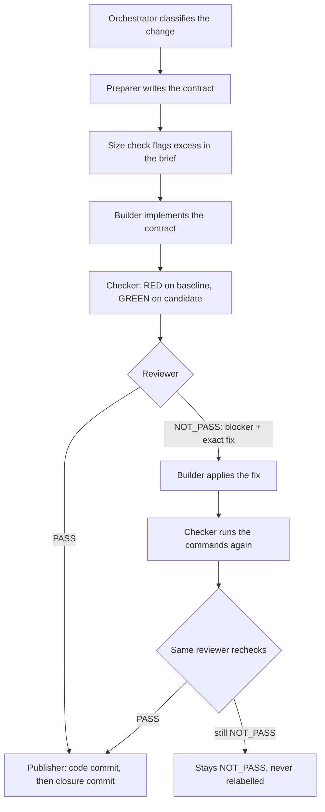
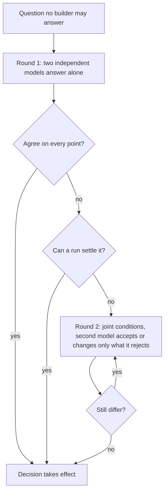
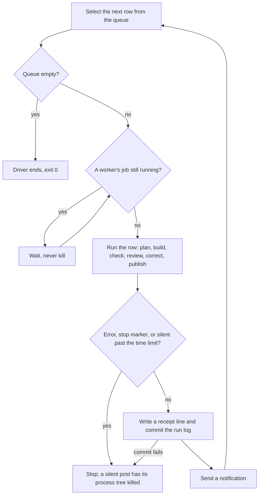

# How it works, end to end

The teamloop has two kinds of work. **Building** changes something and proves it. **Deciding** answers a
question the builders must not answer for themselves. The first is a chain of roles; the second is a
structured exchange between two independent models. This page follows both from start to finish.

## 1. Classify before anything starts

In a manual chain the orchestrator (the main AI session I direct) reads the change and picks a risk class, K0a to K3
([01-roles.md](01-roles.md)). The class decides which steps below run. A record fix has no agents at all; a
guarded-code change gets a reviewer with an attack task; an architecture change gets a reviewed contract first.
Doubt never raises the class. Only the orchestrator's decision moves it, and a real doubt goes to the deciders
(section 3).

## The two routes as diagrams





The driver of the autonomous loop, which takes the orchestrator's place:



## 2. The building chain

```
orchestrator  classifies, opens the chain, relays briefs unchanged
     |
preparer      writes the contract: claims, rules, allowed files, RED/GREEN commands, done criteria
     |
size check    a cheap model flags excess in the brief (content the contract does not require)
     |
builder       implements exactly the contract in the allowed files (and reports what it could not run)
     |
checker       runs the contract's commands: RED must fail on the baseline, GREEN must pass on the candidate
     |
reviewer      tries to break it with one named attack task; verdict PASS or NOT_PASS
     |                         |
     |                NOT_PASS: blockers, each with evidence and the exact fix text
     |                         |
     |                one correction by the builder, the same checks again, the same reviewer rechecks
     v
publisher     two deterministic commits (code, then closure) after a PASS on exactly those bytes
```

What each hand-over carries:

* **Preparer to builder:** the contract and a diff-intent (what will change and why), written before any code.
* **Builder to checker:** a candidate with a manifest of every changed file and its hash.
* **Checker to reviewer:** the exit codes and raw outputs, bound to the candidate's identity.
* **Reviewer to builder (on NOT_PASS):** a fix request that copies the reviewer's fix text unchanged.
* **Reviewer to publisher (on PASS):** a verdict naming the candidate it judged.

Rules that hold the chain together:

* Whoever builds never judges. The reviewer edits no file, and the orchestrator writes no code.
* One correction and one recheck by default; a failed recheck stays NOT_PASS and is not relabelled.
* Caps (rounds, time) are reported, not enforced as stops: going over a cap is counted and visible, and the
  work continues.
* Evidence is reused only if it is tied to the same bytes and inputs; otherwise the affected check runs again.

[04-walkthrough-not-pass-to-pass.md](04-walkthrough-not-pass-to-pass.md) follows one real run through this
chain with its timings.

### Where the loop's work ends

In a manual chain the orchestrator starts each role. In the loop a **driver** takes its place: a small program
that picks the next row from the queue, runs the loop's own command for that row, writes one receipt line and
one commit of the run log, and sends a notification. The driver decides nothing about a row's content. It stops,
and does not go on to the next row, when a post exits with an error, prints a stop marker, goes silent past its
time limit (the driver then kills that post's process tree), or when its own commit fails.

Inside a row the loop runs the whole chain above without help: from planning to an approved, published
candidate. That candidate is the output: a code commit and a closure commit that closes the audit row, made on
the loop's own branch after a PASS on exactly those bytes. Neither the loop nor the driver merges into the main
line. Merging a published candidate is a separate step, taken by the orchestrator.

The loop, with its driver, is autonomous and I am not involved while it runs. By my standing order (25 November 2026,
[07-my-role-and-decisions.md](07-my-role-and-decisions.md)) nobody touches any chain while the loop is working on
rows. The loop is frozen at the moment, so that order has not yet
been exercised; the four recorded closures in [05-evidence-four-closures.md](05-evidence-four-closures.md) were
made before it.

## 3. The decision route

Some questions are not builder or reviewer questions: how something should be built, what to do about an
obstacle, which limit value to use, how to read an unclear blocker. The orchestrator does not decide those
alone, and it does not hand them to the human either. They go to two independent models.

```
question written once, same material to both, with a time limit
     |
round 1: each answers alone, as numbered conditions (about twelve at most, none dropped to meet the count)
     |
agree on every point? ---- yes ----> the decision takes effect
     |
     no
     v
can a run settle it? ---- yes ----> run it; the result decides, not an argument
     |
     no
     v
round 2: the first writes joint conditions; the second answers AGREE, or changes only the
         conditions it rejects and names them
     |
still differ? ---- further rounds on the differing conditions only, until they agree
```

Rules of the route:

* **The orchestrator relays and settles nothing.** It passes each answer on verbatim and adds no argument of
  its own. When both have answered it checks the joint answer against what the human has said he wants and
  sends back what does not meet it.
* **A disagreement ends only in agreement.** Not in a status quo with both positions recorded, not in a hybrid
  the orchestrator assembles from disputed conditions, and not in a question to the human. While rounds
  continue, the standing decision stands; with none, the disputed change is not adopted.
* **A run beats a reading.** If a measurement or a test can settle a disagreement, it is run first, and a number
  without provenance is not accepted.
* **Receipts.** Every answer is saved as a file. A decision without one does not exist.
* **What stays human.** The decisions are the orchestrator's within the human's standing orders. What the human
  keeps is the small list of acts no agent may perform, for example entering credentials, and standing orders
  such as not starting the loop's driver without his word.

The recorded history shows the route in use: for audit row K117, two deciders were asked about the result, the
rules and the efficiency of the run. They answered in round 1, agreed on several points and split on others,
and were sent a second round, whose recorded answers still list points where they differed (see
[06-limits.md](06-limits.md), section 5). I have not traced how that was finally resolved.

## 4. Proof, receipts and gates around both

Every step above leaves a receipt ([03-receipts.md](03-receipts.md)), and gates refuse to continue when a rule
is broken, such as starting an agent without a registered chain ([02-gates.md](02-gates.md)). At the end of a
session a protocol writes a digest of what happened, what was decided, what was left open and where each open
item lives, so the next session starts from files, not from memory.

## 5. What the human does

The human sets the goals and the standing orders, reads the outcomes, corrects the orchestrator when it errs,
and performs the few acts reserved to him. Everything between a goal and its outcome follows the chain and the
decision route above.
